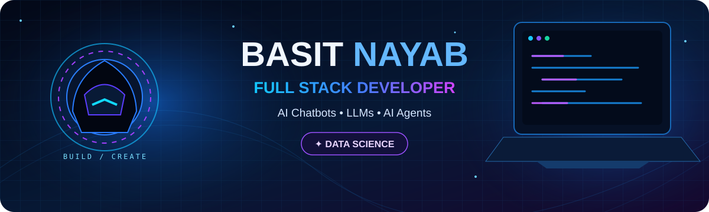

<!-- BASIT NAYAB | NEON CYBERPUNK PROFILE -->

  
  

---

<table>
<tr>
<td width="34%" valign="top">

<h3>◈ SYSTEM PROFILE</h3>

**Basit Nayab**

Full Stack Developer

AI Chatbots · LLMs · AI Agents

🎓 Data Science

[GitHub](https://github.com/basitnayab1) · [Repositories](https://github.com/basitnayab1?tab=repositories)

</td>
<td width="66%" valign="top">

<h3>◈ ABOUT THE DEVELOPER</h3>

I build modern full-stack applications and intelligent AI-powered systems, combining web technologies with LLMs, chatbots, automation, and agent-based workflows.

- Developing end-to-end web applications.
- Building AI chatbots and LLM-powered tools.
- Exploring autonomous agents and intelligent automation.
- Turning practical problems into useful software.

</td>
</tr>
</table>

## ◈ CORE SYSTEMS

<table>
<tr>
<td align="center" width="33%">

### ⌘ FULL STACK
Frontend · Backend  
Web Apps · APIs  
Database Systems

</td>
<td align="center" width="33%">

### ✧ GENERATIVE AI
AI Chatbots  
LLM Integration  
Prompt Engineering

</td>
<td align="center" width="33%">

### ⬡ AI AGENTS
Agentic Workflows  
Task Automation  
Intelligent Systems

</td>
</tr>
</table>

## ◈ TECHNOLOGY MATRIX

 

## ◈ DEPLOYED PROJECTS

## ◈ GITHUB TELEMETRY

---

### ◈ CODE. AUTOMATE. INNOVATE.

*“Let's build something intelligent.”*  
**Basit Nayab**

